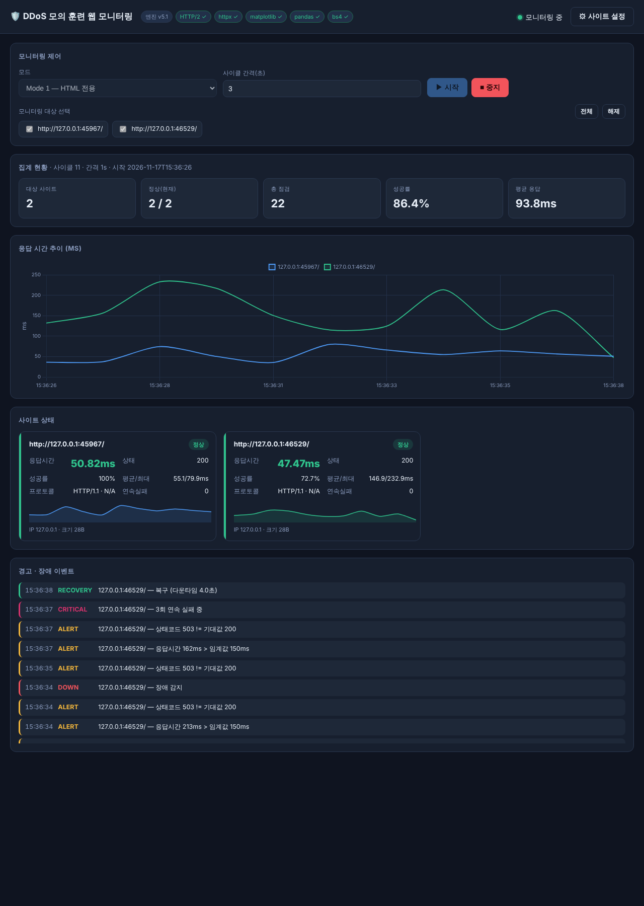

# DDoS 모의 훈련 웹 모니터링 (Web UI)

DDoS 모의 훈련 중 대상 웹사이트의 **응답 시간 · 상태 코드 · 가용성**을
브라우저 대시보드에서 실시간으로 모니터링하는 도구입니다.

기존 CLI 측정 엔진(`web_monitor_drill.py`, v5.1)을 **그대로 재사용**하고,
그 위에 Flask 기반 웹 UI(`app.py`)를 얹었습니다. 엔진의 핵심 기능
(HTTP/2, TLS 버전 감지, DDoS 장비 인증 쿠키 처리, 재시도/폴백, 멀티사이트
병렬 측정)이 웹에서도 동일하게 동작합니다.

> ⚠️ **용도**: 본 도구는 **인가된 DDoS 모의 훈련 · 가용성 점검**을 위한
> 모니터링(관측) 도구입니다. 대상 서버로 공격 트래픽을 생성하지 않으며,
> 주기적으로 GET 요청을 보내 응답을 관측합니다. 반드시 **본인 소유이거나
> 명시적으로 점검 권한을 받은 시스템**에만 사용하십시오.



---

## 주요 기능

- **웹 대시보드**: 사이트별 상태 카드, 응답 시간 추이 차트, 집계 현황
- **실시간 이벤트**: 임계값 경고(ALERT) · 장애 감지(DOWN) · 복구(RECOVERY) ·
  연속 실패(CRITICAL) 로그 — 엔진 CLI의 FA01/FA02/FA03 로직 재현
- **사이트 설정 편집**: 브라우저에서 `sites.json`을 직접 추가/수정/삭제/저장
- **3가지 모니터링 모드**
  - Mode 1 — HTML 전용
  - Mode 2 — HTML + 리소스 다운로드
  - Mode 3 — 지연 분해(DNS / TCP / TLS / 서버응답 / 본문)
- **오프라인/에어갭 지원**: Chart.js를 저장소에 포함(vendored)하여 외부망이
  차단된 내부망에서도 차트가 정상 동작
- **CLI 100% 유지**: 기존 `python web_monitor_drill.py` 터미널 실행도 그대로 사용 가능

---

## 빠른 시작

### 1) 설치

```bash
python -m venv venv
source venv/bin/activate        # Windows: venv\Scripts\activate
pip install -r requirements.txt
```

`requirements.txt`의 선택 패키지(httpx[http2], beautifulsoup4, matplotlib,
pandas, openpyxl)가 없어도 동작하지만, HTTP/2·Mode 2·CLI 리포트 기능이 제한됩니다.

### 2) 웹 UI 실행

```bash
python app.py
# http://127.0.0.1:5000 접속
```

환경 변수로 바인드 주소/포트/설정 파일을 지정할 수 있습니다.

```bash
HOST=0.0.0.0 PORT=8080 SITES_FILE=/path/to/sites.json python app.py
```

브라우저에서:
1. **⚙ 사이트 설정**에서 모니터링할 사이트를 등록(또는 기본 `sites.json` 사용)
2. **모니터링 대상**을 체크하고 **모드 · 사이클 간격** 선택
3. **▶ 시작** → 실시간 결과 확인, **■ 중지**로 종료

### 3) 기존 CLI 실행 (선택)

```bash
python web_monitor_drill.py                       # 대화형 모드
python web_monitor_drill.py --mode 1 --sites 0 --interval 3 --auto
```

CLI는 종료 시 `monitoring/` 폴더에 텍스트 로그 · Excel · 그래프를 저장합니다.

---

## sites.json 형식

```json
[
  {
    "url": "https://example.com/",
    "ip": "",
    "ddos_auth": true,
    "http2": true,
    "check_string": "ok",
    "impersonate": "chrome",
    "resource_timeout": 10,
    "save_path": "",
    "alert_thresholds": {
      "max_response_time_ms": 2000,
      "expected_status_code": 200
    }
  }
]
```

| 필드 | 설명 |
|------|------|
| `url` | 모니터링 대상 URL (필수) |
| `ip` | 고정 IP 직접 연결(선택). DNS 조회 생략, Host 헤더는 도메인 유지 |
| `ddos_auth` | DDoS 장비 인증 쿠키(302/403+Cookie, 챌린지) 자동 처리 |
| `http2` | HTTP/2 사용 여부(기본 true). false면 HTTP/1.1 고정 |
| `check_string` | 응답 본문에 포함되어야 하는 문자열(콘텐츠 검증) |
| `resource_timeout` | 요청 타임아웃(초) |
| `alert_thresholds.max_response_time_ms` | 초과 시 ALERT |
| `alert_thresholds.expected_status_code` | 불일치 시 ALERT |

---

## REST API

| 메서드 | 경로 | 설명 |
|--------|------|------|
| `GET`  | `/api/engine` | 엔진 버전/기능 가용성 |
| `GET`  | `/api/sites` | 저장된 사이트 목록 |
| `POST` | `/api/sites` | 사이트 목록 전체 교체 저장 `{sites:[...]}` |
| `POST` | `/api/monitor/start` | 모니터링 시작 `{urls, interval, mode}` |
| `POST` | `/api/monitor/stop` | 모니터링 중지 |
| `GET`  | `/api/monitor/status` | 현재 상태 · 사이트별 결과 · 이벤트 |

---

## Docker

```bash
docker build -t web-monitor-drill .
docker run --rm -p 5000:5000 \
  -v "$PWD/sites.json:/app/sites.json" \
  web-monitor-drill
# http://127.0.0.1:5000
```

---

## 프로젝트 구조

```
.
├── app.py                 # Flask 웹 서버 (REST API + 대시보드)
├── monitor_service.py     # 백그라운드 모니터링 관리자 (스레드 안전)
├── web_monitor_drill.py   # 측정 엔진 (CLI 겸용, v5.1) — 함수 미수정
├── sites.json             # 기본 사이트 설정
├── templates/index.html   # 대시보드 UI
├── static/chart.umd.js    # Chart.js (vendored, 오프라인 동작용)
├── tests/smoke_test.py    # 로컬 서버 기반 엔드투엔드 스모크 테스트
├── requirements.txt
└── Dockerfile
```

---

## 테스트

외부 네트워크 없이 로컬 HTTP 서버를 띄워 전체 흐름을 검증합니다.

```bash
python tests/smoke_test.py
```

GitHub Actions(`.github/workflows/ci.yml`)에서 Python 3.10 / 3.12로 자동 실행됩니다.

---

## 참고

- **운영 배포 시**: `app.py`는 Flask 개발 서버를 사용합니다. 외부에 노출할 때는
  gunicorn 등 WSGI 서버 뒤에 두는 것을 권장합니다. 단, 모니터링 상태는
  단일 프로세스 메모리에 보관되므로 워커는 1개로 운용하십시오
  (`gunicorn -w 1 --threads 8 app:app`).
- **엔진 수정 없음**: 웹 계층은 엔진 함수를 import하여 호출만 합니다. 엔진의
  기존 CLI 동작과 함수 시그니처는 변경하지 않았습니다.
